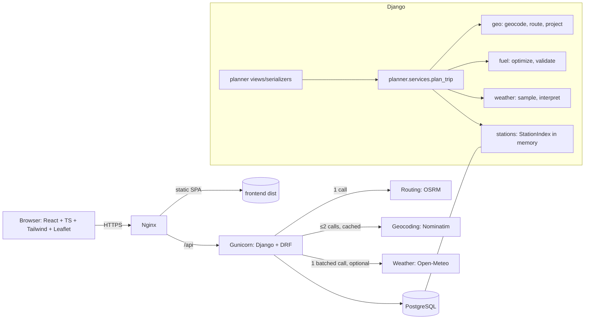
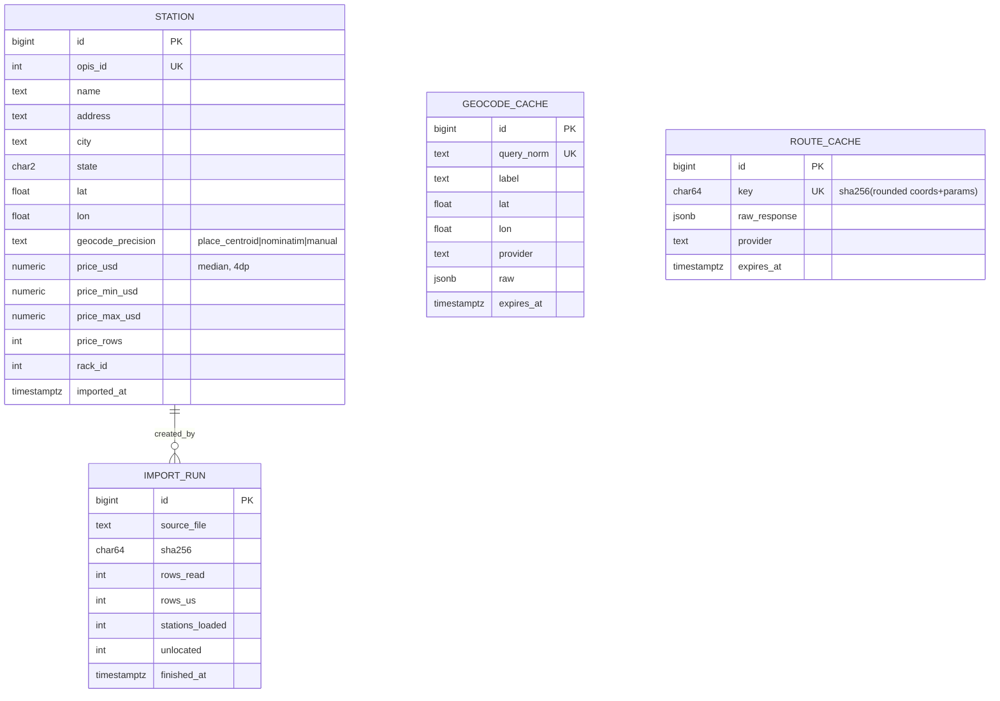

# ARCHITECTURE.md — FuelRoute

Source of truth for structure and technology. Numeric rules live in ALGORITHM.md; endpoint contracts live in API_SPEC.md. Priority tags: **P0** assessment-mandatory, **P1** high-value, **P2** extended, **P3** future.

## 0. Assessment analysis and key findings

| Finding | Evidence | Decision |
|---|---|---|
| The CSV has **no coordinates**. | Columns: `OPIS Truckstop ID, Truckstop Name, Address, City, State, Rack ID, Retail Price`. | Stations must be located before any spatial matching (§6.1). Positions are city-centroid precision. |
| The CSV contains **Canadian rows**. | 620 rows with AB, BC, MB, NB, NS, ON, QC, SK, YT. | Excluded at import (US-only product). 7,531 US rows remain. |
| The CSV has **duplicate stations**. | 7,531 US rows → 6,626 unique `OPIS Truckstop ID`; 568 IDs carry several prices (mean spread $0.10, max $0.90); 227 IDs carry more than one name spelling. | Collapse per ID with the **median** price; most frequent name. |
| Price range. | $2.687 – $6.399 per gallon (all rows). | Validate `0 < price ≤ 20` at import. |
| Address strings are highway descriptors ("I-80, EXIT 226"), not street addresses. | ~60% of US rows contain `I-<n>`. | Do not geocode addresses; locate by place (§6.1). Exit parsing is P3. |
| "One call to the map API is ideal, two or three acceptable." | Assessment email. | Hard budget: **1 routing call + ≤ 2 geocoding calls per cold request; 0 external calls for the fuel computation**. |
| Weather is not part of the assessment. | Prompt §2. | Weather is **P1**, optional per request, and its failure never fails the request. |

## 1. System overview

FuelRoute accepts two US locations, obtains up to three driving routes from **one** routing call, finds stations near each route using an in-memory spatial match over the 6,626 imported stations, computes a provably-feasible minimum-cost fuel plan per route (ALGORITHM.md), optionally annotates each route with a weather summary, recommends one route, and returns a single JSON document the React map renders.



## 2. Technology decisions

| Area | Choice | Why | Alternatives rejected |
|---|---|---|---|
| Backend | **Django 6.1.x** + DRF (pin `Django>=6.1,<6.2`; implementer verifies the latest stable at https://www.djangoproject.com/download/ and the supported Python versions before pinning) | Assessment requires latest stable Django. A search listing showed 6.1.2 published in October 2026, but I did not read the release notes. | FastAPI (violates requirement). |
| Python | 3.13 (confirm it is listed as supported for the pinned Django) | Current, broad wheel support. | — |
| DB | **PostgreSQL 17** (plain, no PostGIS) | Required. 6.6k stations: spatial matching is done in numpy; indexes on `(state)` suffice. | **PostGIS**: justified only at >100k points or ad-hoc spatial SQL. Adds image weight and migration risk for no measurable gain → P3. |
| Cache | Django DB cache (`createcachetable`) + domain cache tables | Shared by all Gunicorn workers, survives restarts, zero extra services. | **Redis**: would give global rate-limiting and faster cache; rejected for P0/P1 (extra service). Revisit at P2 if >1 host. Cross-worker Nominatim throttling uses a Postgres advisory lock instead. |
| Async jobs | None. Request is synchronous. | Work is ≈ 100–400 ms CPU; one external call dominates. | **Celery**: no long-running/background work exists. |
| Numerics | `numpy` | Vectorized projection and DP. | pure Python loops (too slow), `shapely`/`geopandas` (heavy, unnecessary). |
| Polyline | `polyline` (PyPI) | Decode OSRM `polyline6`. | custom decoder. |
| HTTP client | `httpx` with timeouts, 1 retry on 5xx/timeouts | Sync use in Django, easy mocking with `respx`. | `requests` acceptable but no benefit. |
| Server | Gunicorn (2–3 sync workers) behind Nginx; WhiteNoise not used (Nginx serves static) | Simple, robust. | uvicorn/ASGI: no async need. |
| Frontend | React 19 + TypeScript + Vite + Tailwind CSS v4 + **Leaflet via react-leaflet** + TanStack Query | Requirement. Leaflet is small, raster-tile based, trivial polyline/marker API. | MapLibre GL JS (vector tiles need a tile server/provider; better UI but more setup). |
| Frontend styling convention | Tailwind v4 via **co-located plain CSS files** using `@reference` + `@apply`; no utility strings in JSX | Matches the team's convention of plain CSS beside each component while still using Tailwind. | Inline utility classes. |
| Frontend tests | Vitest + React Testing Library + MSW | Standard for Vite. | Jest. |
| Infra | Docker, Docker Compose, Nginx, GitHub Actions, Linux VPS | Required. | Kubernetes (overkill). |

## 3. External service evaluation

Facts below are from the providers' public pages as searched on 2026-11-05. Items marked ⚠ were not confirmed from a primary source and **must be re-verified by the implementer before relying on them**.

| Capability | Provider | Limits / terms | Alternatives in one request? Batching? | Verdict |
|---|---|---|---|---|
| Routing | **OSRM public demo** (`router.project-osrm.org`) | Wiki: "reasonable, non-commercial" use, **max 1 request/s**, no uptime guarantee, attribution (ODbL/OSRM) required, valid User-Agent required, access may be withdrawn. | `alternatives=true` is documented; `alternatives=<n>` (n ≤ 3) ⚠ verify on a US route; the server may return fewer. Geometry: `geometries=polyline6&overview=full`. | **Assessment & development default.** Not for production. |
| Routing | **OSRM self-hosted** (`osrm/osrm-backend`, MLD) | Your own limits. US extract needs several GB of RAM and a one-time `osrm-extract/partition/customize` (hours) ⚠ size depends on Geofabrik file. | Same API. | **Production recommendation** (P2: `docker-compose.osrm.yml` profile). |
| Routing | **OpenRouteService** public API | Free plan: Directions **2,000/day, 40/min**; max route 6,000 km. **Alternative routes are limited to 100 km on the public API and max 3 routes**. | Alternatives work only up to 100 km → useless for cross-country. | Rejected as primary. Optional provider behind the same interface (P3). |
| Geocoding | **Nominatim public** | **Absolute max 1 request/s per application**, valid identifying User-Agent/Referer, **cache results**, no bulk geocoding, no autocomplete. Attribution to OpenStreetMap contributors. | No batching. Use `countrycodes=us&limit=1&format=jsonv2`. | Assessment default; cache every result for 30 days; global 1 req/s throttle. Not for production at scale. |
| Geocoding | ORS Geocoding (Pelias) | Free plan 1,000/day, 100/min ⚠ | — | Fallback provider (P3). |
| Weather | **Open-Meteo** `api.open-meteo.com/v1/forecast` | Free tier is **non-commercial**, ≈10,000 calls/day (soft), no key; commercial use requires a paid plan ⚠ confirm current price. Attribution requested/required (CC BY 4.0). | **Yes: multiple `latitude`/`longitude` comma-separated lists in one request** (announced up to 1,000 locations). Hourly forecasts up to 16 days. | **Recommended** for P1 weather. |
| Weather | US NWS `api.weather.gov` | Free, no key, US-only, but needs `/points/{lat},{lon}` then forecast fetch per point (2 calls/location), requires User-Agent. | No batching. | Rejected: too many calls. |
| Map tiles | **tile.openstreetmap.org** | OSMF Tile Usage Policy: no heavy use, valid Referer/User-Agent, attribution; unsuitable for production traffic. | — | OK for local dev / the assessment demo. Tile URL is an env var (`VITE_TILE_URL`) so a commercial/self-hosted provider is a config change. |
| Map library | **Leaflet 1.9 + react-leaflet** | BSD-2. | — | Selected. |

**Final recommendation.** Assessment: OSRM demo + Nominatim + Open-Meteo, all behind provider interfaces (`RoutingProvider`, `GeocodingProvider`, `WeatherProvider`) with caching and strict call budgets. Production: self-hosted OSRM, a geocoder with a commercial/self-hosted plan (or pass coordinates from the UI), Open-Meteo paid plan (or disabled), a commercial tile provider. **Trade-off accepted:** the demo endpoints may throttle or disappear during review, so every external call has a timeout, a cache, a precise error code, and fixtures for offline demonstration (`apps/geo/fixtures/`).

## 4. Repository layout (monorepo)

```
fuelroute/
├── AGENTS.md  ASSESSMENT.md
├── docs/{ALGORITHM.md, API_SPEC.md, ARCHITECTURE.md, DEPLOYMENT.md, PLAN.md, TESTING.md}
├── scripts/{record_fixtures.py, live_smoke.py}
├── backend/
│   ├── manage.py  pyproject.toml  requirements/{base,dev}.txt  Dockerfile
│   ├── config/{settings/{base,dev,prod,test}.py, urls.py, wsgi.py}
│   ├── apps/
│   │   ├── common/        constants.py  errors.py  exception_handler.py  middleware.py (request id, timing)  logging.py
│   │   ├── stations/      models.py  services/index.py  management/commands/import_stations.py  data/
│   │   ├── geo/           geometry.py  providers/{base,nominatim,osrm}.py  models.py (GeocodeCache, RouteCache)  throttle.py
│   │   ├── fuel/          optimizer.py  validator.py  candidates.py  types.py
│   │   ├── weather/       providers/{base,open_meteo}.py  sampling.py  interpret.py
│   │   └── planner/       views.py  serializers.py  urls.py  services.py  selection.py  health.py
│   └── tests/{unit,integration,api,perf}/  fixtures/
├── frontend/
│   ├── package.json  vite.config.ts  tsconfig.json  Dockerfile  nginx.conf (SPA only)
│   └── src/
│       ├── app/            App.tsx  App.css  providers.tsx
│       ├── features/
│       │   ├── route-planner/  RoutePlannerForm.tsx/.css  useRoutePlan.ts  api.ts  types.ts
│       │   ├── map/            RouteMap.tsx/.css  StopMarker.tsx/.css
│       │   ├── fuel-plan/      FuelPlanPanel.tsx/.css  CostBreakdown.tsx/.css
│       │   ├── weather/        WeatherStrip.tsx/.css
│       │   └── route-comparison/ ComparisonTable.tsx/.css
│       ├── shared/         ui/  lib/format.ts  lib/http.ts  styles/tailwind.css
│       └── test/           msw handlers, setup
├── deploy/{docker-compose.yml, docker-compose.prod.yml, nginx/fuelroute.conf, scripts/}
├── data/fuel-prices-for-be-assessment.csv   (original, never edited)
└── .github/workflows/{ci.yml, deploy.yml}
```

Dependency direction (enforced in review and by an import-linter test): `planner → fuel, geo, weather, stations → common`. `fuel` imports **nothing** from Django, DRF, HTTP clients or the ORM (pure functions over dataclasses) so the optimizer is unit-testable without a database.

## 5. Database design (PostgreSQL)



* `STATION`: unique `opis_id`; index `(state)`; `CHECK (price_usd > 0 AND price_usd <= 20)`; `CHECK (lat BETWEEN 24 AND 50 AND lon BETWEEN -125 AND -66)`. Unlocated stations are **not loaded** (counted in `IMPORT_RUN.unlocated`, listed in the command output).
* `GEOCODE_CACHE.query_norm` = lowercase, trimmed, collapsed whitespace, punctuation stripped. TTL 30 days. Negative results are cached 1 hour (`lat/lon` null).
* `ROUTE_CACHE.key` = sha256 of `provider|profile|alternatives|lat/lon rounded to 4 decimals`. TTL 24 h.
* Django DB cache table `fuelroute_cache`: weather (TTL 1 h) and full plan responses (TTL 1 h; key includes `stations_data_version` = `IMPORT_RUN.sha256` so a re-import invalidates plans).
* Weather and plans are not modeled as relational tables: nothing queries them relationally.

### 5.1 Station import (P0, `python manage.py import_stations --csv data/... [--refresh-coords]`)

1. Read CSV with the stdlib `csv` module (no pandas anywhere in the repo). Strip whitespace, upper-case `State`.
2. Drop non-US states (everything outside the 50 US state codes; D.C. is absent from the data). Drop rows with `price ≤ 0` or `> 20`.
3. Group by `OPIS Truckstop ID`: `price_usd = median(Retail Price)`, `min`, `max`, `price_rows = count`; `name = most frequent Truckstop Name` (ties → alphabetical first); `address, city, state, rack_id` = first (verified: constant per ID).
4. Locate: normalize `(city, state)`; look up in `apps/stations/data/us_places.csv` (**derived from the US Census Gazetteer places file (public domain) — implementer downloads it once, commits the trimmed CSV with columns `city_norm,state,lat,lon`**) ⚠ source URL not verified here. Unmatched cities (expected ≤ a few hundred) → single-threaded Nominatim lookups at ≤ 1 req/s with a descriptive User-Agent (one-time; policy allows small single-thread jobs), results written to `apps/stations/data/geocode_overrides.csv` and committed. Remaining unmatched → excluded and reported.
5. `bulk_create(..., update_conflicts=True, unique_fields=['opis_id'])` in a transaction; write `IMPORT_RUN`. The command is idempotent and runs in CI against a fixture.

All stations get `geocode_precision = "place_centroid"` unless overridden. The API discloses this (`meta.data.station_position_precision`).

## 6. Geospatial and fuel pipeline

### 6.1 Request lifecycle (cold)

```mermaid
sequenceDiagram
  participant C as Client
  participant V as PlanView
  participant S as plan_trip()
  participant G as GeocodeCache/Nominatim
  participant R as RouteCache/OSRM
  participant I as StationIndex
  participant F as optimizer
  participant W as Open-Meteo
  C->>V: POST /api/v1/routes/plan
  V->>V: validate (serializer), request_id
  V->>S: PlanRequest
  S->>S: plan cache lookup (hit → return)
  S->>G: geocode start, finish (cache first; ≤2 calls)
  S->>R: 1 call, alternatives (cache first)
  loop each route (≤3)
    S->>S: decode, scale, simplify
    S->>I: candidates within corridor (numpy)
    S->>F: optimize + validate
  end
  S->>W: 1 batched call for all samples (optional, 3 s timeout)
  S->>S: weather interpret, select route (ALGORITHM §10)
  S-->>V: PlanResult
  V-->>C: 200 JSON (+ X-Request-ID)
```

Order of work is fixed so that the P0 result exists before weather is attempted; weather runs last and is wrapped in a handler that converts any exception into `weather.status = "unavailable"`.

### 6.2 Route geometry processing

1. Decode `polyline6` → `float64[N,2]` `[lat, lon]`.
2. Cumulative haversine distance, rescaled to OSRM's `distance` (meters → miles).
3. Two simplified copies: **matching** (tolerance 0.05 mi) and **display** (tolerance 0.25 mi, then hard cap of 2,000 vertices by increasing tolerance). Display geometry is returned as GeoJSON `LineString` `[lon, lat]`.

### 6.3 Station matching, detour, optimization
Exactly as in ALGORITHM.md §4–§6; `StationIndex` holds `lat, lon, price, id` numpy arrays loaded once per worker at first use (`apps.stations.services.index.get_index()`, thread-safe lazy singleton, reloaded when `stations_data_version` changes). The matching code takes the arrays, not ORM objects.

### 6.4 Route evaluation strategy
Each route is independent: its own candidates, its own plan, its own weather. Selection is ALGORITHM §10. Comparison metrics returned for each route: distance, duration, total fuel cost, number of stops, average price per gallon, weather risk level, delta vs the recommended route.

### 6.5 Weather integration (P1)

* **Sampling.** For each route: samples at mile 0, every 100 miles, and the destination; max 12 per route (stride widens for very long routes). Each sample has `eta = departure + duration × (mile / D)` (departure = request time, or `options.departure_time` ISO-8601, ≤ 14 days ahead).
* **One call.** All samples of all routes are de-duplicated by `(round(lat, 1), round(lon, 1))` and requested together:
  `GET https://api.open-meteo.com/v1/forecast?latitude=a,b,…&longitude=a,b,…&hourly=temperature_2m,precipitation,weather_code,wind_speed_10m,wind_gusts_10m,visibility&temperature_unit=fahrenheit&wind_speed_unit=mph&precipitation_unit=inch&timezone=UTC&forecast_days=16`
  The response is an array in request order; the hour matching the ETA (rounded to the nearest hour) is selected.
* **Interpretation** (`weather/interpret.py`, table-driven, covered by unit tests):

| Condition | Severity |
|---|---|
| WMO 0–3 | none |
| WMO 45, 48 (fog) or visibility < 1 mi | moderate |
| WMO 51–55, 61, 63, 80, 81 | low |
| WMO 65, 82 or precipitation ≥ 0.25 in/h | moderate |
| WMO 71, 73, 85 | moderate |
| WMO 56, 57, 66, 67 (freezing rain/drizzle), 75, 77, 86, 95, 96, 99 | severe |
| Gusts ≥ 30 mph | moderate; ≥ 45 mph → severe |
| Temp ≤ 28 °F with precipitation > 0 | severe |

  Sample severity = max of its triggers. Route `risk_level` = `severe` if any sample is severe, else `moderate` if ≥ 2 samples moderate or any sample moderate with `precip ≥ 0.1`, else `low` if any sample low/moderate, else `none`. The summary string is generated from the worst two samples ("Snow near mile 420 (ETA 14:20 UTC)").
* **Failure policy.** 3 s timeout, no retry; HTTP error → `weather.status = "unavailable"`, request still 200. ETA beyond 16 days → `status = "partial"` with the affected samples marked `unavailable`.

### 6.6 Caching strategy

| Layer | Key | TTL | Purpose |
|---|---|---|---|
| Plan response (DB cache) | `plan:v1:{data_version}:{sha256(coords 4dp + options)}` | 1 h | Identical repeat requests → 0 external calls, no recompute. |
| `ROUTE_CACHE` | rounded coords + params | 24 h | Avoid routing call when only options change. |
| `GEOCODE_CACHE` | normalized query | 30 d (neg 1 h) | Nominatim policy + speed. |
| Weather (DB cache) | `wx:{lat.1f}:{lon.1f}:{YYYYMMDDHH}` | 1 h | Reuse across overlapping routes/requests. |
| `StationIndex` | process memory | until data version changes | No DB access on the request path. |

Cache failures are logged and bypassed; they never fail a request. Plans containing `weather.status = "unavailable"` are **not** cached.

### 6.7 Call budget guarantee
`meta.external_calls` is part of every response. Cold worst case: geocoding 2, routing 1, weather 1 = 4 (3 for the P0 core). A test asserts the cold counts and that a repeated identical request produces zero calls. Coordinates supplied directly (`lat/lon`) skip geocoding.

### 6.8 Rate limiting and throttling
* Inbound: DRF throttle `AnonRateThrottle` 30/min per IP on `/routes/plan` (configurable).
* Outbound Nominatim: global 1 request/s using `pg_advisory_lock(<constant>)` to reserve a scheduled execution timestamp under the lock (setting `next_available = max(now, last_reserved + 1.05s)` in the cache/DB table and immediately releasing the lock). Sleeping until `next_available` and executing the HTTP call occur outside the lock to prevent worker starvation. If the lock isn't acquired within 3 s → `UPSTREAM_UNAVAILABLE`.

## 7. Backend layers
* **Views** (thin): parse → `PlanRequestSerializer` → `plan_trip()` → `PlanResponseSerializer`. No logic.
* **Services**: `planner/services.py::plan_trip` orchestrates; each step is a function with explicit inputs/outputs (dataclasses in `fuel/types.py`, `geo/types.py`).
* **Providers**: interfaces in `providers/base.py`; concrete classes use `httpx`, timeouts (connect 2 s / read 8 s routing, 5 s geocoding, 3 s weather), `User-Agent: FuelRoute/1.0 (+<APP_CONTACT_URL>)`. The contact URL/email comes from env `APP_CONTACT`; **never default it to a personal address**.
* **Errors**: `common/errors.py` defines `ApiError(code, http_status, message, details)`; `exception_handler.py` converts `ApiError`, DRF `ValidationError`, `Http404`, throttles and unknown exceptions into the single error envelope (API_SPEC §3).

## 8. Frontend architecture
* Single page. `RoutePlannerForm` (two text inputs + options) → `useRoutePlan` (TanStack Query mutation) → results state.
* `RouteMap`: Leaflet map, all routes drawn (recommended = solid thick, others = dashed grey, click to select), start/finish markers, numbered stop markers with popups (station, price, gallons, cost), weather sample dots coloured by severity, OSM attribution control.
* Panels: `FuelPlanPanel` (stop table + totals), `CostBreakdown`, `WeatherStrip`, `ComparisonTable`. Loading, empty, error (error `code` → human message map in `shared/lib/errors.ts`), and "weather unavailable" states are required.
* Types in `features/route-planner/types.ts` mirror API_SPEC exactly; a contract test parses the example response in API_SPEC §6 (extracted to `frontend/src/test/fixtures/plan.example.json`).
* No global state library. Env: `VITE_API_BASE_URL` (default `/api/v1`), `VITE_TILE_URL`, `VITE_TILE_ATTRIBUTION`.

## 9. Security
| Concern | Control |
|---|---|
| Secrets | Only via env/`.env` (never committed); `.env.example` committed with dummy values. |
| Django | `DEBUG=False` in prod, `ALLOWED_HOSTS`, `SECURE_*` headers, `CSRF` not needed for the stateless JSON API (no cookies/sessions used; `SessionMiddleware` kept only for admin if enabled — admin is **off** by default). |
| CORS | `django-cors-headers`, allow-list from `CORS_ALLOWED_ORIGINS` (not needed when served same-origin via Nginx). |
| Input | DRF serializers, strict field lengths and ranges (API_SPEC §4); no user input reaches SQL strings or shell. |
| SSRF | Upstream hosts are fixed settings; user input is only ever a query parameter value. |
| Abuse | Inbound throttle (§6.8); request body limit 4 KB (Nginx `client_max_body_size 8k`). |
| Dependencies | `pip-audit` and `npm audit --omit=dev` in CI (fail on high). |
| Containers | Non-root user, read-only root FS where feasible, no secrets in images. |
| Logging | No raw coordinates at INFO for anonymous users beyond rounded 2 dp; no IP stored beyond Nginx logs. |
| Privacy | The app stores only query text and coordinates in caches; no user accounts. |

## 10. Logging and observability
JSON logs (`python-json-logger`) with `request_id`, `method`, `path`, `status`, `duration_ms`, and for the plan endpoint `external_calls`, `cache_hits`, `candidates`, `dp_ms`, `matching_ms`, `route_count`. Nginx access log with `$request_id`. `X-Request-ID` is accepted from Nginx or generated. Timings per stage are returned in `meta.timings_ms` and logged.

## 11. Scalability considerations (documented, mostly not built)
* Stateless web workers; state is in Postgres. Horizontal scaling = more Gunicorn workers/containers; each holds ~1 MB of station arrays.
* DP memory: worst case ≈ 22 MB per in-flight route (ALGORITHM §8). 3 routes × 3 workers ≈ 200 MB peak; set container memory limit 768 MB.
* The bottleneck is the external routing call; self-hosted OSRM removes it. Pre-warm common city pairs (P3).
* Redis, PostGIS, Celery: triggers for adopting each are listed in §2.

## 12. Priorities map

| Priority | Components |
|---|---|
| P0 | Importer, geocode, one routing call, matching, optimizer + validator, `POST /routes/plan` (best route + stops + total cost + geometry), caching of geocode/route, validation/errors, tests, README, Loom checklist |
| P1 | Alternatives + comparison, weather, health endpoints, React UI + map, Docker/Compose, CI, structured logging, perf measurement |
| P2 | Production Nginx/HTTPS deploy, backups, self-hosted OSRM profile, `GET /stations`, Redis (if needed) |
| P3 | Exit-level station geocoding, PostGIS, ORS provider, pre-warming, user accounts/history |
