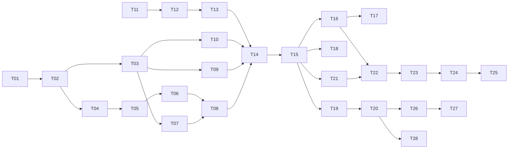

# PLAN.md — FuelRoute Execution Roadmap

Companion documents: ARCHITECTURE.md (structure), API_SPEC.md (contracts), ALGORITHM.md (numbers/optimizer), TESTING.md, DEPLOYMENT.md, AGENTS.md (agent rules).

## 1. Objectives

1. **Primary (P0):** a correct, tested Django API that, given two US locations, returns the route geometry, cost-optimal fuel stops under a 500-mile range, and total fuel money at 10 MPG, using the supplied CSV, with ≤ 3 external map/routing calls per request and fast responses. Delivered with a GitHub repository and a ≤ 5-minute Loom demo.
2. **Extended (P1–P2):** alternatives comparison, weather, React + map UI, Docker/CI, production deployment.

## 2. Deadline and time budget

* Email received **2026-11-04 23:59 (Africa/Addis_Ababa)** → hard deadline **2026-11-07 23:59** local. This plan was written 2026-11-05/06; roughly 42 hours remain at the start of Day 2.
* Hours below are *agent-assisted wall-clock including review and test runs*, not manual coding time.
* **Submission target: 2026-11-07 18:00** (6 h buffer for upload/recording problems).

| Day | Date | Scope | Hours | Exit gate |
|---|---|---|---|---|
| 1 | Nov 4–5 | Assessment analysis, this blueprint | — (done) | Seven documents approved |
| 2 | Nov 6 | Phases 0–4 (**all P0**) | ≈ 13.5 | Tag `v0.1.0`: P0 complete, tests green, README + Postman collection. **A submittable project exists tonight.** |
| 3 | Nov 7 | Phase 5 (P1: alternatives, weather, Docker/CI, UI) → record Loom → submit | ≈ 8.75 + 1.5 Loom/README | Tags `v0.2.0` (backend P1) and `v0.3.0` (UI); submission by 18:00 |
| after | — | Phase 6 (P2 deployment) and P3 | ≈ 5.75 | Does not delay submission |

**Cut rule.** If Day 2 ends without `v0.1.0`, Day 3 is spent only on P0 completion, tests and the Loom. P1 items are dropped in this order: UI polish → weather → alternatives. Do not drop T21–T24 before weather. Never drop tests or the README.

**"Return a map of the route" interpretation.** The assessment's API must return the route; the response carries GeoJSON geometry (P0) which any map renders. T21–T24 provide an actual Leaflet map (P1) and are scheduled on Day 3 morning before polish tasks. If time is short, the README documents pasting `routes[0].geometry` into https://geojson.io as the fallback viewer.

## 3. Scope

### In scope
P0 (mandatory): CSV import (US only, de-duplicated, located) · geocoding of two locations · one OSRM call · route geometry and distance · station matching along the route · fuel optimization (exact DP, 500 mi, 10 MPG) · stops, purchases, total cost · input validation · error envelope · caching of geocode and route · automated tests · README · Loom/Postman material.
P1: up to 3 alternative routes and comparison · weather sampling/interpretation · plan cache · structured logging · health endpoints · `/config` · Docker + Compose (dev) · GitHub Actions CI · React + TypeScript + Tailwind + Leaflet UI · performance measurement script.
P2: production Compose + Nginx + HTTPS · GitHub Actions deploy · backups/rollback scripts · self-hosted OSRM profile · `GET /stations`.
P3: exit-level station geocoding · PostGIS · Redis · ORS provider · cache pre-warming · accounts/history.

### Non-goals (do not build, even if "easy")
User accounts or auth · saved trips · multi-stop waypoints · turn-by-turn instructions · live traffic/tolls · other fuel types, EVs, vehicle profiles or tank sizes chosen by the user · Canada/Mexico · live price updates/scraping · admin UI · notifications · i18n · payments · PostGIS/Redis/Celery in P0–P2.

## 4. Priority matrix

| ID | Capability | Pri |
|---|---|---|
| R1–R3 | Two locations → geocode → route geometry/distance | P0 |
| R4 | ≤ 3 external calls (1 routing) | P0 |
| R5–R9 | CSV prices, 500 mi, 10 MPG, stops, total cost | P0 |
| R10 | Fast response (measured) | P0 |
| R11 | Latest stable Django | P0 |
| R15–R16 | Validation and errors | P0 |
| R19 | CSV cleaning (US only, dedupe) | P0 |
| R14 | Route comparison | P1 |
| R13 | Weather | P1 |
| R12b | React map | P1 |
| R18 | Docker, CI | P1; production deploy P2 |

## 5. Task dependency graph

## 6. Phases and tasks

Rules: one task at a time; every task ends with its listed verification run, a commit, and the report format in AGENTS.md §9. The agent stops for approval at the end of each phase.

### Phase 0 — Foundation (P0, ≈ 2.0 h)

| ID | Task | Depends | Est | Acceptance criteria | Verify | Commit |
|---|---|---|---|---|---|---|
| T01 | Repo scaffold: directory tree (ARCHITECTURE §4, with `docs/`, `scripts/`, `deploy/`), `.gitignore`, `.env.example`, `README.md` skeleton, record CSV sha256 (`c704371f141ded9c54df6c32d488a0ba2ceb589f88c936c967daa5330e0cd241`, 8,152 lines, 577,081 bytes) in README (fail T01 if it differs), `ruff` + `pytest` configs | — | 0.5 | Tree matches ARCHITECTURE §4; `data/…csv` sha256 equals reference; no secrets | `ls`, `sha256sum` | `chore: scaffold repository [T01]` |
| T02 | Django project `config` with settings split, DRF JSON-only renderer, Postgres via `POSTGRES_*` env, `docker-compose.yml` with `db` only, pinned `requirements/` | T01 | 0.75 | Latest stable Django verified against djangoproject.com and recorded in README; `python manage.py check` passes; `migrate` runs against Compose Postgres | `docker compose up -d db`, `manage.py check`, `migrate` | `feat(config): django project and settings [T02]` |
| T03 | `apps/common`: `constants.py` (every constant of ALGORITHM §2), `ApiError`, exception handler producing API_SPEC §3 envelope, request-id middleware, `GET /api/v1/health/live` | T02 | 0.75 | Unknown path returns envelope with `request_id`; `X-Request-ID` on every response; constants file matches ALGORITHM §2 value-for-value | `pytest tests/unit/common` | `feat(common): errors, request id, liveness [T03]` |

**Testing checkpoint 0:** `pytest` green; `ruff check` clean.

### Phase 1 — Station data (P0, ≈ 2.25 h)

| ID | Task | Depends | Est | Acceptance criteria | Verify | Commit |
|---|---|---|---|---|---|---|
| T04 | `Station`, `ImportRun` models + migration with CHECK constraints and indexes (ARCHITECTURE §5) | T02 | 0.25 | Migration applies/reverses; constraint rejects price 0 and out-of-US coordinates | model tests | `feat(stations): models [T04]` |
| T05 | `import_stations` command (ARCHITECTURE §5.1); prepare `us_places.csv` from the Census Gazetteer and `geocode_overrides.csv` (single-thread ≤ 1 req/s, descriptive User-Agent from `APP_CONTACT`); create test fixtures `backend/tests/fixtures/stations_mini.csv` and `backend/tests/fixtures/places_mini.csv`; commit all | T04 | 1.5 | On the supplied CSV: 8,151 rows read, 7,531 US rows, 6,626 distinct `opis_id`; Canadian rows excluded; unlocated count printed and ≤ 5% of stations; second run changes nothing; prices equal the per-ID median | `manage.py import_stations --csv data/…`; `pytest tests/integration/test_import.py` | `feat(stations): csv importer [T05]` |
| T06 | `StationIndex` lazy singleton (numpy arrays) + `stations_data_version` | T05 | 0.5 | Loads 6,626 stations < 100 ms; index reloads when version changes; zero DB queries after load | unit test with `django_assert_num_queries(0)` | `feat(stations): in-memory index [T06]` |

**Testing checkpoint 1:** importer integration test green; counts above reproduced.

### Phase 2 — Geospatial and external providers (P0, ≈ 3.75 h)

| ID | Task | Depends | Est | Acceptance criteria | Verify | Commit |
|---|---|---|---|---|---|---|
| T07 | `geo/geometry.py`: polyline6 decode, haversine, cumulative distance with OSRM-distance rescale, Douglas–Peucker (two tolerances) | T03 | 1.0 | Known-distance fixtures within 0.1%; simplified route within tolerance of original (property test); display geometry ≤ 2,000 points | `pytest tests/unit/geo/test_geometry.py` | `feat(geo): geometry primitives [T07]` |
| T08 | `fuel/candidates.py`: bbox prefilter, chunked point-to-segment projection, corridor filter, route-mile, offset, detour, dominance pruning (ALGORITHM §4, §8) | T06, T07 | 1.0 | Synthetic grid cases return exact miles/offsets; loop-back rule; coast-to-coast fixture match ≤ 150 ms; stations > 10 mi away excluded | unit + perf test | `feat(fuel): candidate matching [T08]` |
| T09 | `GeocodingProvider` (Nominatim), `GeocodeCache`, normalization, negative cache, global 1 req/s throttle with advisory lock, `countrycodes=us`, US bounding-box check | T03 | 1.0 | Second identical query makes 0 HTTP calls; User-Agent from env, never empty; 429/5xx/timeout mapped to API_SPEC codes; two concurrent calls ≥ 1.05 s apart | `pytest tests/unit/geo/test_geocoding.py` (respx) | `feat(geo): geocoding with cache [T09]` |
| T10 | `RoutingProvider` (OSRM): one call `…/route/v1/driving/{lon,lat};{lon,lat}?overview=full&geometries=polyline6&alternatives=…&steps=false`, `RouteCache`, `NoRoute` mapping; handle `len(routes) < requested` gracefully (probe result: alternatives=3 returned 2 routes for NYC→Chicago); create `scripts/record_fixtures.py` and commit recorded fixtures `backend/tests/fixtures/osrm_*.json`, `nominatim_*.json` | T03 | 0.75 | Exactly one HTTP call per cold request; cached afterwards; `NoRoute` → `ROUTE_NOT_FOUND`; handles fewer alternatives than requested; recorded fixtures `tests/fixtures/osrm_*.json` committed | `pytest tests/unit/geo/test_routing.py` | `feat(geo): osrm provider [T10]` |

**Testing checkpoint 2:** all unit tests green; no real network in tests (autouse blocker, TESTING §3).

### Phase 3 — Optimizer (P0, ≈ 2.75 h)

| ID | Task | Depends | Est | Acceptance criteria | Verify | Commit |
|---|---|---|---|---|---|---|
| T11 | `fuel/types.py` frozen dataclasses (`Candidate`, `Node`, `Purchase`, `FuelPlan`, `Infeasible`) | T03 | 0.25 | No Django/ORM imports in `apps/fuel` (import-linter test) | `pytest tests/unit/test_architecture.py` | `feat(fuel): types [T11]` |
| T12 | `fuel/optimizer.py` DP exactly as ALGORITHM §6 (strict-tie rule, origin node, stop penalty, margin, reserve, grid unit configurable for tests) | T11 | 1.5 | Worked examples A, B, C of ALGORITHM §11 reproduce ($278.00, break-even 41.6 gal, infeasible gap 550); E1–E13 each have a passing test | `pytest tests/unit/fuel/test_optimizer*.py` | `feat(fuel): dp optimizer [T12]` |
| T13 | `fuel/validator.py` (ALGORITHM §6.7) + brute-force oracle + property tests | T12 | 1.0 | Oracle equals DP on ≥ 200 random small instances; validator passes every plan; DP cost ≤ "fill at every stop" baseline and ≥ `D/MPG × min price` | `pytest tests/unit/fuel/test_oracle.py -q` | `test(fuel): oracle and properties [T13]` |

**Testing checkpoint 3:** `apps/fuel` coverage ≥ 95% (line and branch).

### Phase 4 — P0 API and hardening (P0, ≈ 2.75 h)

| ID | Task | Depends | Est | Acceptance criteria | Verify | Commit |
|---|---|---|---|---|---|---|
| T14 | `planner`: serializers (API_SPEC §4.1/4.2), `plan_trip()` for the first route only, `POST /api/v1/routes/plan`, response with geometry, stops, totals, `meta.external_calls` | T08, T09, T10, T13 | 1.25 | Fixture request NYC→Chicago returns 200 matching the API_SPEC §6 *schema*; `total_fuel_cost_usd` = Σ stop costs to the cent; cold external calls = geocoding 2 + routing 1 (mocked counters) | `pytest tests/api/test_plan.py` | `feat(planner): plan endpoint [T14]` |
| T15 | Hardening: validation matrix (API_SPEC §4.1), every error code reachable and tested, call-budget tests; create `scripts/live_smoke.py` and `backend/tests/perf/measure.py`; README (setup, run, import, example curl, assumptions, limitations, Loom script), Postman collection `docs/FuelRoute.postman_collection.json` | T14 | 1.5 | TESTING §9 scenarios AT-01…AT-09, AT-11, AT-12 and AT-15 pass (AT-10, AT-13, AT-14 belong to P1: T16–T19); perf numbers recorded in README; one live smoke run with real OSRM/Nominatim done manually and its output saved to `docs/live-smoke.json` | `pytest`, `python tests/perf/measure.py` | `feat: p0 hardening and docs [T15]` → tag **`v0.1.0`** |

**Gate G0 (end of Day 2):** P0 definition of done (§8) satisfied. Stop and request approval.

### Phase 5 — P1 (≈ 8.75 h, Day 3)

| ID | Task | Depends | Est | Acceptance criteria | Verify |
|---|---|---|---|---|---|
| T16 | Alternatives: request `alternatives=true` (still 1 routing call), per-route pipeline, handle cases where OSRM returns fewer routes than requested (e.g. 2 instead of 3), route selection (ALGORITHM §10), `comparison[]`, `recommendation` | T15 | 1.0 | With 3-route synthetic fixture and 2-route live fixture: each route has an independent plan; handles `len(routes) < requested`; recommended route obeys §10 rules; infeasible routes returned with `status="infeasible"` | `tests/unit/planner/test_selection.py`, API test |
| T17 | Weather: provider, sampling (100 mi, ≤ 12/route, de-duplicated), single batched call, interpretation table (ARCHITECTURE §6.5), failure → `status="unavailable"` | T16 | 1.5 | Exactly 1 weather call for 3 routes; every table row has a test; weather timeout still returns 200 with correct fuel plan | `tests/unit/weather/*`, API test with respx failing weather |
| T18 | Plan cache + `createcachetable`; cache key includes data version; not cached when weather unavailable | T15 | 0.5 | Repeat request: 0 external calls, `meta.cache.plan="hit"`, p95 < 50 ms | API test |
| T19 | JSON logging, per-stage timings in `meta.timings_ms`, `GET /health/ready`, `GET /config`, inbound throttle | T15 | 0.5 | Log line per request has all fields of ARCHITECTURE §10; 31st request/min from one IP → 429 with `Retry-After` | tests |
| T20 | `backend/Dockerfile`, dev `docker-compose.yml` (db + web), `.github/workflows/ci.yml` (TESTING §12) | T19 | 1.25 | `docker compose up --build` then `curl /api/v1/health/ready` → 200 after `import_stations`; CI green on a push | local run, Actions run |
| T21 | Frontend scaffold (Vite, TS strict, Tailwind v4, co-located CSS convention, Vitest, MSW, ESLint) | T15 | 0.5 | `npm run lint && npm run typecheck && npm test && npm run build` pass | commands |
| T22 | `RoutePlannerForm`, `useRoutePlan`, typed API client, error-code → message map | T21, T16 | 0.75 | Form validates like API_SPEC §4.1; loading/error states; types parse API_SPEC §6 fixture | Vitest |
| T23 | `RouteMap` (Leaflet): routes, selection, start/finish, numbered stop markers + popups, weather dots, attribution | T22 | 1.0 | Renders with fixture; stop popups show station, price, gallons, cost; attribution visible | Vitest + manual screenshot |
| T24 | `FuelPlanPanel`, `CostBreakdown`, `WeatherStrip`, `ComparisonTable` | T23 | 1.0 | Totals equal API numbers; weather-unavailable state; keyboard-accessible route selection | Vitest |
| T25 | Frontend test hardening to coverage target + final backend/frontend integration smoke | T24 | 0.75 | Coverage ≥ 70% lines (TESTING §11) | `npm run test:coverage` |

Tags: `v0.2.0` after T20 (backend P1 complete), `v0.3.0` after T25. **Submission after `v0.3.0` (or `v0.2.0` if the cut rule triggered).**

### Phase 6 — P2 (after submission, ≈ 5.75 h)

| ID | Task | Est | Acceptance criteria |
|---|---|---|---|
| T26 | `docker-compose.prod.yml`, Nginx conf, HTTPS via certbot, `deploy.yml`, VPS runbook (DEPLOYMENT.md) | 2.5 | `https://<domain>/api/v1/health/ready` 200 with valid certificate; deploy from a tag works |
| T27 | Backups and rollback scripts | 0.75 | Restore into a scratch DB verified; `rollback.sh` returns to the previous tag |
| T28 | Self-hosted OSRM compose profile | 2.0 | `OSRM_BASE_URL` switch passes the same fixture-based tests and a live smoke |
| T29 | `GET /stations` | 0.5 | API_SPEC §5 pagination tests |

### P3 backlog (no scheduling)
Exit-level geocoding of "I-xx, EXIT nnn"; PostGIS; Redis; ORS provider; pre-warm popular city pairs; history/accounts.

## 7. Git checkpoints

* Branches: `main` (always green) and short-lived `task/Txx-slug`; merge by fast-forward or squash after the task's verification passes.
* Commit format: `type(scope): summary [Txx]` with `type ∈ feat|fix|test|docs|chore|refactor|ci`.
* Tags: `v0.1.0` (after T15), `v0.2.0` (after T20), `v0.3.0` (after T25), `v1.0.0` (after T26 deploy).
* Never commit secrets, `.env`, node_modules, `__pycache__`, database dumps.

## 8. Definition of done

**P0 done** when all hold:
1. `pytest` green with coverage targets of TESTING §11; `ruff` clean; no real network in tests.
2. `import_stations` on the supplied CSV reproduces: 7,531 US rows → 6,626 stations; Canadian rows excluded.
3. `POST /api/v1/routes/plan` for the AT-01 (NYC → Chicago) and AT-02 (Los Angeles → New York) fixtures returns valid plans; the validator passes; every stop is reachable under 500 mi.
4. Cold request external calls ≤ 3 (verified by test and by `meta.external_calls` in the live smoke); repeat request 0.
5. README documents setup in ≤ 8 commands, assumptions (ALGORITHM §2), limitations (city-centroid station positions, OSRM demo server), measured performance.
6. Postman collection exists; Loom script (§9) rehearsed.
7. Repository contains no secrets; `APP_CONTACT` is an env var, not a hard-coded address.

**Project done** adds: P1 items complete and tested; CI green; UI works against the API; DEPLOYMENT.md steps verified on a VPS (P2); AGENTS.md rules followed in the commit history.

## 9. Loom checklist (≤ 5 min)

| Time | Content |
|---|---|
| 0:00–0:30 | Problem, assumptions (500 mi, 10 MPG, empty start, median prices, city-centroid positions). |
| 0:30–2:30 | Postman: NYC → Chicago (show geometry, stops, totals, `meta.external_calls`); repeat request (cache hit, 0 calls); an error case (`LOCATION_NOT_FOUND`); a long route (LA → NYC). |
| 2:30–4:15 | Code tour: `planner/services.py` → `geo/geometry.py` + `fuel/candidates.py` → `fuel/optimizer.py` (explain exact DP, reachability proof, validator). |
| 4:15–5:00 | `pytest` run with coverage, perf numbers, what is next. |

## 10. Risk register

| Risk | Impact | Mitigation |
|---|---|---|
| OSRM demo down or slow during recording | Demo fails | Record with cached responses; fixtures in repo; `OSRM_BASE_URL` swap. |
| Nominatim blocks the User-Agent | No geocoding | Real descriptive UA via `APP_CONTACT`; cache; allow `lat/lon` input. |
| Census place names don't match CSV cities | Stations unlocated | Normalization rules + overrides file; report; ≤ 5% threshold test. |
| DP too slow for 3 coast-to-coast routes | Latency miss | Dominance pruning, `MAX_CANDIDATES`, measured in T15; fall back to `FUEL_UNIT_GAL = 0.05` only with approval (ALGORITHM §6.4 bound grows to ≈ $2). |
| Django version mismatch with Python | Build failure | Check supported Python in T02 before pinning. |
| Scope creep from P2/P3 | Missed deadline | Cut rule (§2); agent rule against out-of-scope work (AGENTS.md §10). |
